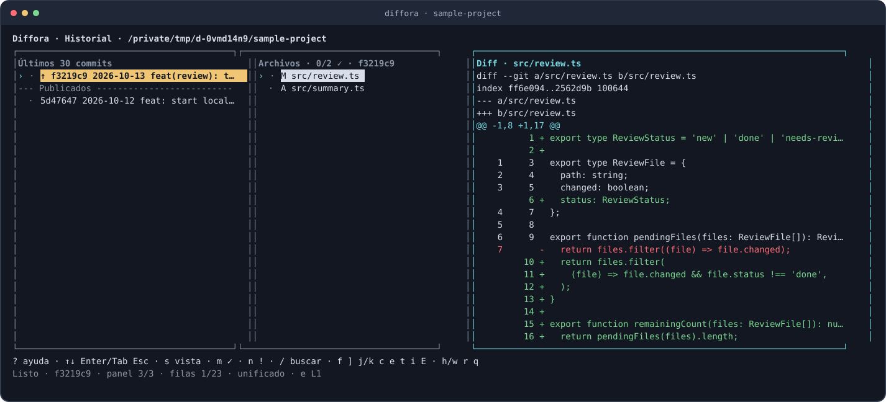
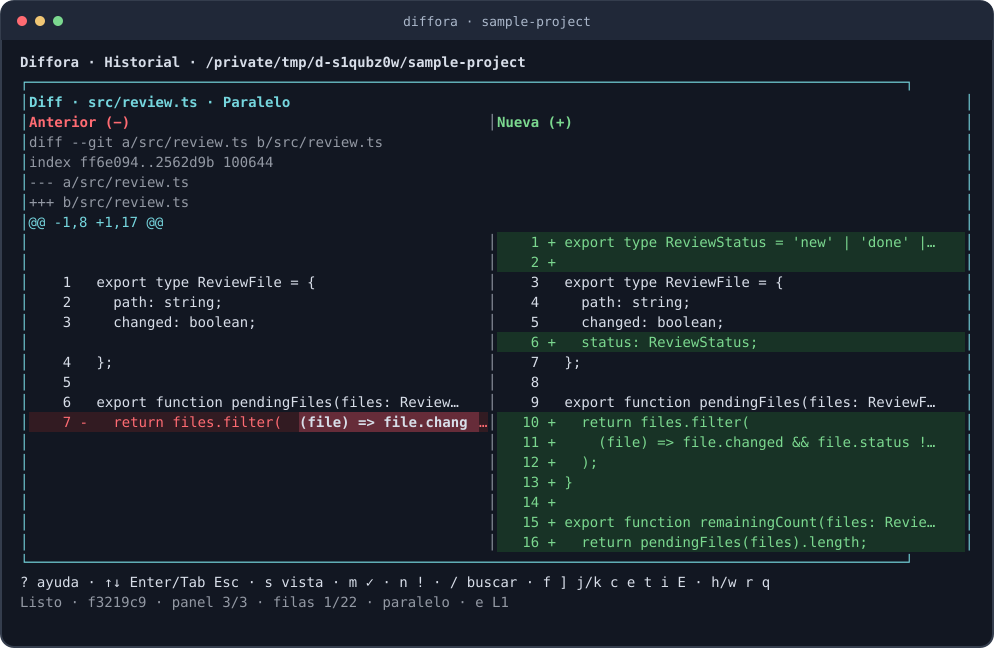

# Diffora

[](https://github.com/JoseMLuzu/diffora/actions/workflows/ci.yml)
[](https://www.npmjs.com/package/diffora)
[](LICENSE)

**Review Git changes without leaving your terminal.**

Diffora helps you inspect the work left by a coding agent—or your own work—before you move on. Browse commits and pending changes, open diffs and image previews, and keep track of files that still need attention.

It reads Git without staging, committing, checking out, or pushing. Review marks, notes, and reports stay outside the repository. No account, server, or AI service is needed.

[Guía en español](docs/usage.es.md) · [Contributing](CONTRIBUTING.md) · [Report an issue](https://github.com/JoseMLuzu/diffora/issues)



*Captured from a temporary sample repository. Colors may vary with your terminal theme.*

## Get started

Requires **Node.js 22.13+**, npm, Git, and an interactive terminal.

```sh
npm install --global diffora
cd /path/to/your-project
diffora
```

Already in another directory? Run `diffora --repo "/path/to/your project"`. The older `terminal-review` command remains an alias.

**Local vs. global install:** `npm i diffora` installs into the current project's `node_modules`; run it there with `npx diffora`. Use `npm install --global diffora` if you want the bare `diffora` command from any directory. Check the CLI with `diffora --version` (or `npx diffora --version` for a local install).

If global installation stops with `EEXIST` for `.../bin/terminal-review`, an older globally linked `terminal-review` command is occupying Diffora's compatibility alias. Remove that old global link, then install Diffora:

```sh
npm uninstall --global terminal-review
npm install --global diffora
rehash # zsh: refresh the command lookup
diffora --version
```

Run these with the same Node installation you use for Diffora (for example, the same `fnm` version). This does not remove the source checkout; it only removes the old global command.

> **First run:** press `w` for pending changes or `h` for commits. Use ↑/↓ and Enter to move from a category or commit to its files, then to a diff. Press `?` for help and `q` to save and exit.

### What you can review

| View | What it shows |
| --- | --- |
| **History** | The latest 30 commits, with short hash, title, date, and an `↑` for commits not in locally known upstream history |
| **Pending · Unstaged** | Working-tree changes compared with the index |
| **Pending · Staged** | Index changes compared with `HEAD` |
| **Pending · Untracked** | New files shown as added content |

Each view leads to a file list and then a diff. Deleted and renamed files are included. Normal commits compare with their parent, the first commit with an empty tree, and merge commits with their **first parent**.

The `↑` indicator uses local remote-tracking references. Diffora does not fetch from GitHub; fetch or push as usual, then press `r` to refresh.

## Why use it?

- **Readable diffs:** unified or side-by-side text, old/new line numbers, highlighted edits, and shortcuts between change blocks.
- **Image previews:** PNG, JPEG, WebP, GIF, TIFF, and AVIF, with a key to switch between the previous and new version.
- **A place to resume:** mark files green when done or orange when they need another look; add notes, filter unfinished files, and see outstanding tasks.
- **Fits your terminal:** keyboard navigation, one panel at a time on narrow screens, and draggable panel borders on wide screens.
- **Keeps review local:** progress is saved per repository; export a Markdown report when you want a record.

## Compare code side by side

Press `s` while viewing a text diff to put the previous version on the left and the new version on the right. Red and green backgrounds highlight changed lines, with stronger emphasis on the edited parts. Press `s` again to return to the unified diff.



*Real terminal output from the same sample repository. Between 80 and 109 columns, the diff fills the screen; colors may vary by terminal theme.*

## Keyboard guide

The bottom bar shows only the most useful keys for the active panel. Press `?` for the complete guide, grouped by task.

| Key | Action |
| --- | --- |
| ↑ / ↓, Enter | Select, scroll, and open |
| Tab / Shift+Tab, Esc | Change panel or go back |
| `h` / `w` / `r` | History / pending changes / refresh |
| `/` | Search file paths |
| `m` / `n` | Mark done (green) / needs another review (orange) |
| `c` | Write or edit a note |
| `f` / `]` | Show unfinished files / jump to the next one |
| `j` / `k` | Next / previous diff block |
| `s` | Switch unified / side-by-side text diff |
| `v` | Switch previous / new image |
| `e` | Open the current working-tree file in an editor |
| `t` / `i` / `E` | Tasks / summary / export Markdown report |
| `?` | Full help |
| `q` / Ctrl+C | Save and exit |

Side-by-side diffs need at least 80 columns. Below 110 columns, Diffora shows one panel at a time. The terminal's original screen is restored on exit.

## Language

Diffora reads your device's preferred language when it starts. It uses Spanish for Spanish locales and English for other locales. The viewer, help, text mode, notices, and exported reports use that language. File contents, paths, and commit messages retain their original text.

To choose a language for one run, set `DIFFORA_LANG`:

```sh
diffora                 # use the device language
DIFFORA_LANG=es diffora # Spanish
DIFFORA_LANG=en diffora # English
```

The override also works with `--repo`, `--text`, and `--open` on macOS. Run `diffora --help` to see the CLI guide in the selected language.

## Use it with Codex or Claude Code

Install the chat skills once:

```sh
diffora --install-skills
```

The skills call `diffora` directly, so install it globally first.

Then use **`$diffora` in Codex** or **`/diffora` in Claude Code**. Restart the agent if the new skill does not appear. On macOS, the skill runs `diffora --open` to open the interactive viewer in a **separate Terminal.app window**; return to the chat after pressing `q`. The viewer does not appear inside the chat.

To launch that window yourself, run `diffora --open --repo "/path/to/your project"`. If application launch is restricted, run `diffora` directly in your terminal. The ordinary viewer and text mode also work outside macOS.

For a text response in a conversation or a script, use:

```sh
diffora --text
diffora --text --source staged --file 1
diffora --text --commit abc1234 --file 1 --offset 80 --limit 80
```

Text mode accepts `unstaged`, `staged`, and `untracked` sources. File numbers start at 1; diff offsets start at 0. Run `diffora --help` for all options.

## Install from source

If you prefer the source checkout, or want to contribute:

```sh
git clone https://github.com/JoseMLuzu/diffora.git
cd diffora
npm ci
npm run build
npm install --global .
```

Python 3 is needed only for the interactive terminal tests. Keep npm optional dependencies enabled: Sharp uses platform-specific packages for image previews. A global install needs a writable npm prefix. Without one, run `node /path/to/diffora/dist/cli.js --repo /path/to/project`.

## Review progress and editor

Marks, notes, view preferences, and exports are stored per repository under `~/.local/state/terminal-review/` (or `$XDG_STATE_HOME/terminal-review/`). They do not modify the reviewed repository. A pending file that changes after you mark it loses that mark; its note remains available as stale. Commit marks are tied to the commit hash.

| Variable | Use |
| --- | --- |
| `DIFFORA_STATE_DIR` | Choose a different progress/export directory outside the repository |
| `DIFFORA_EDITOR` | Choose an editor; defaults to `code` and supports `{file}`, `{line}`, `{column}` |
| `DIFFORA_LANG` | Override the detected language with `es` or `en` |

For example: `DIFFORA_EDITOR="cursor --reuse-window" diffora`. The editor opens the **current working-tree file**, even while reviewing an older commit, so its line numbers may differ. The older `TERMINAL_REVIEW_STATE_DIR` and `TERMINAL_REVIEW_EDITOR` variables still work.

## Develop and test

```sh
npm ci
npm run dev -- --repo /path/to/test-repo
npm run typecheck
npm test
npm run build
npm run test:terminal
npm run test:workflow
```

The tests use temporary Git repositories. The last two commands require Python 3 and exercise a real pseudo-terminal, including navigation, screen restoration, and widths of 40, 80, and 140 columns.

| Directory | Responsibility |
| --- | --- |
| `src/cli.ts` | Arguments and terminal lifecycle |
| `src/ui/` | Ink components and keyboard/mouse input |
| `src/application/` | State, Git-query coordination, notes, and reports |
| `src/core/` | Models and diff parsing |
| `src/git/` | Read-only Git commands and fingerprints |
| `src/images/` | Bounded image decoding and terminal previews |

Git runs with separate arguments and without a shell. Pagers and external diff tools are disabled; paths use NUL delimiters, terminal control characters are neutralized, and late responses cannot replace a newer selection.

## Current limits

- Text diffs are capped at **1 MiB / 10,000 lines**; image versions at **10 MiB / 16 megapixels**. Diffora warns when content is truncated or cannot be previewed. Animated images show the first frame.
- Long lines are clipped to the terminal width. There is no horizontal scrolling or search within file content.
- Non-image binaries show a notice. SVG is treated as text; submodules show reference changes rather than nested history.
- Git remote status comes from local refs and can be stale. Concurrent file edits are not read as one atomic snapshot.
- Review marks are human decisions, not a guarantee that code is correct. Progress stays on this machine unless you export it.

More detail is in the [Spanish guide](docs/usage.es.md). Contributions and bug reports are welcome; see [CONTRIBUTING.md](CONTRIBUTING.md). Diffora is released under the [MIT license](LICENSE).
